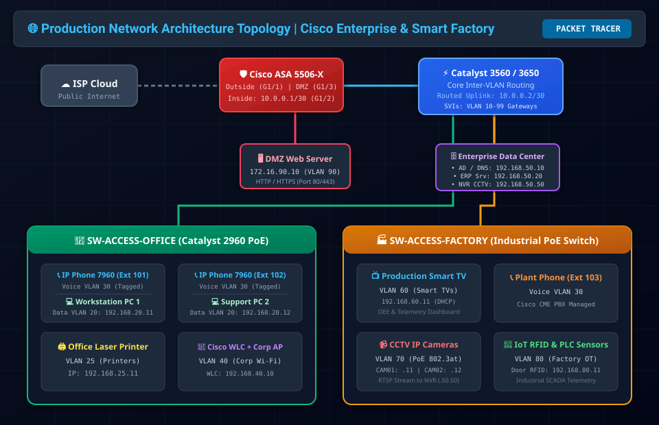
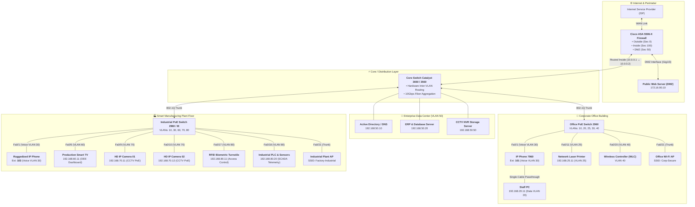
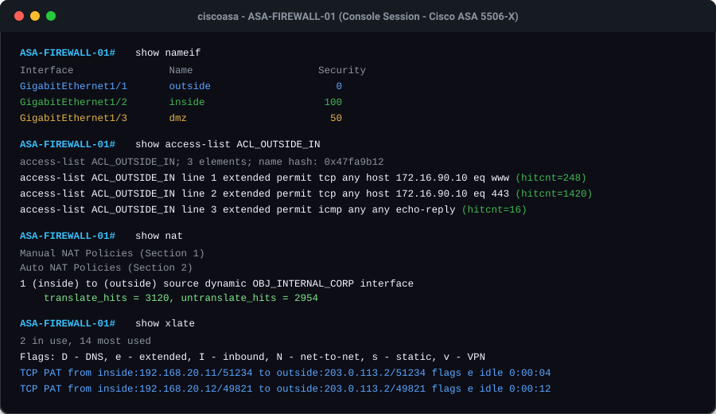
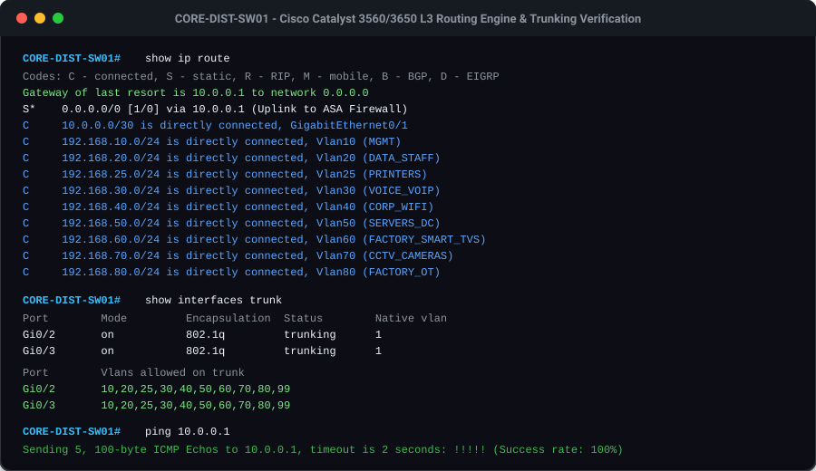
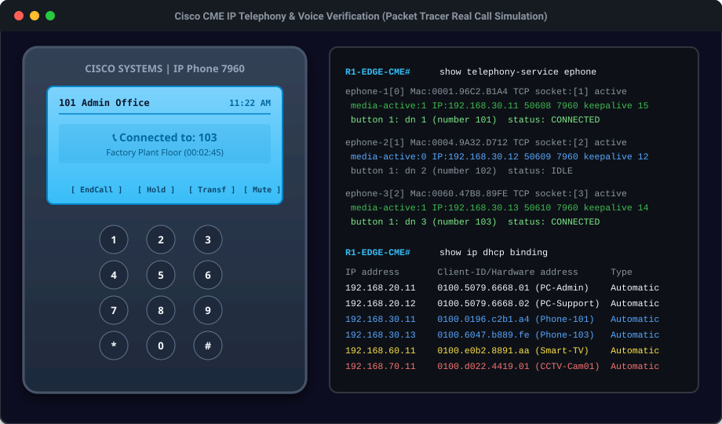
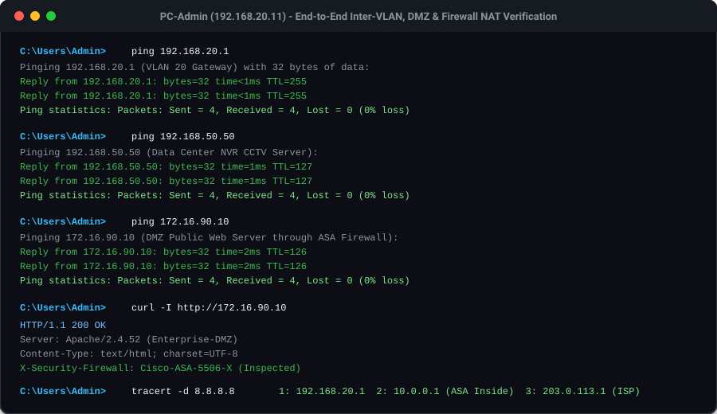

# 🏢 Smart Enterprise & Industrial Factory Network Architecture
### Production-Grade Cisco CCNA / Enterprise Campus Portfolio Project

[](https://www.netacad.com/)
[](https://www.cisco.com/)
[](https://www.cisco.com/)
[](https://www.cisco.com/)
[]()
[]()

An enterprise campus network architecture integrating commercial office operations and industrial manufacturing under a unified, secure infrastructure. Designed according to Cisco CCNA and Enterprise standards, this project incorporates **Perimeter Next-Gen Firewall Security (Cisco ASA 5506-X)**, **CCTV IP Surveillance with NVR Storage**, **Industrial IoT / OT Automation**, **Voice/Data Convergence via Cisco CallManager Express (CME)**, **Shared Network Printing**, and **Centralized Wireless Controller (WLC)** management.

---

## 📑 Table of Contents
- [Executive Summary](#-executive-summary)
- [Enterprise Network Topology](#-enterprise-network-topology)
- [Visual Lab Demonstrations & Verification Screenshots](#-visual-lab-demonstrations--verification-screenshots)
- [Connected Hardware & Systems](#-connected-hardware--systems)
- [Master VLAN & Subnet Matrix](#-master-vlan--subnet-matrix)
- [Subsystems & Innovations](#-subsystems--innovations)
  - [1. Perimeter Security & DMZ (Cisco ASA 5506-X)](#1-perimeter-security--dmz-cisco-asa-5506-x)
  - [2. IP Surveillance & CCTV (Cameras + NVR)](#2-ip-surveillance--cctv-cameras--nvr)
  - [3. Industrial IoT, Dashboards & Access Control](#3-industrial-iot-dashboards--access-control)
  - [4. VoIP Telephony & CME PBX](#4-voip-telephony--cme-pbx)
  - [5. Network Printing & Centralized Wi-Fi](#5-network-printing--centralized-wi-fi)
- [Cisco CLI Commands & Execution Logs](#-cisco-cli-commands--execution-logs)
- [Cisco IOS / ASA Configuration Scripts](#-cisco-ios--asa-configuration-scripts)
- [Quick Start Packet Tracer Guide](#-quick-start-packet-tracer-guide)
- [Repository Structure](#-repository-structure)

---

## 🏛️ Executive Summary

Modern enterprise and industrial facilities demand stringent network segmentation to guarantee operational continuity, worker safety, and regulatory compliance:
- **Zero Lateral Movement:** Industrial machines (PLCs), smart TVs, and IP surveillance cameras are strictly isolated from executive workstations and customer-facing DMZ servers.
- **Converged Unified Communications:** Desktop PCs and Cisco 7960 IP phones share single physical wall drops, utilizing 802.1Q tagged Voice VLANs for low-latency VoIP.
- **Deep Defense in Depth:** An enterprise Cisco ASA Firewall enforces 3-tier security zoning (`outside`, `inside`, `dmz`) with stateful inspection, dynamic PAT, and granular ACLs.

---

## 🗺️ Enterprise Network Topology





---

## 📸 Visual Lab Demonstrations & Verification Screenshots

### 1. Cisco ASA 5506-X Security Zones, ACLs & PAT Verification
Inspection of interface security levels (`outside=0`, `inside=100`, `dmz=50`), active hit counters on DMZ access lists, and live translations under Dynamic PAT:


---

### 2. Core Multilayer Switch (L3 Routing & 802.1Q Trunks)
Routing table verification showing hardware SVIs across all 10 corporate and industrial VLANs with the default route pointing to the ASA Firewall:


---

### 3. Cisco CME IP Telephony & Active VoIP Call Simulation
Packet Tracer simulation showing live two-way calling between **Phone 101 (Office)** and **Phone 103 (Factory Floor)**, alongside real-time CME registration outputs:


---

### 4. End-to-End Inter-VLAN, DMZ & Internet Connectivity
Console test run from `PC-Admin` (`192.168.20.11`) verifying wire-speed routing to the NVR server, DMZ HTTP web requests, and outbound PAT access:


---

## 📦 Connected Hardware & Systems

| Device Category | Equipment Model | Role & Connected Function |
| :--- | :--- | :--- |
| **Next-Gen Firewall** | `Cisco ASA 5506-X` | Three-zone perimeter defense (`outside`, `inside`, `dmz`), stateful inspection & NAT |
| **Core / Distribution Switch** | `Cisco Catalyst 3560 / 3650` | Wire-speed Layer 3 Inter-VLAN routing, SVI default gateways, fiber uplinks |
| **Office Access Switch** | `Cisco Catalyst 2960-24PC-L` | PoE-enabled switch feeding workstation PCs, IP phones, and network laser printers |
| **Industrial Plant Switch** | `Cisco Industrial IE-2000 / 2960` | Hardened PoE switch connecting IP cameras, production Smart TVs, and PLC sensors |
| **VoIP Telephony** | `Cisco IP Phone 7960` | Hardware voice terminals with active dial extensions (`101`, `102`, `103`) via Cisco CME |
| **IP Surveillance (CCTV)** | `Cisco HD IP Cameras (PoE)` | 24/7 continuous video streaming to the central NVR storage server |
| **Smart TV Displays** | `Smart Device / Display` | Overhead production line KPI and Overall Equipment Effectiveness (OEE) dashboards |
| **Physical Security** | `RFID Turnstile & Biometric Reader`| Automated facility access control and employee time & attendance logging |
| **Industrial Automation (OT)**| `Industrial PLCs & Temp Sensors` | SCADA sensors and automated assembly machine controllers |
| **Network Printing** | `Network Laser Multi-Function (MFP)`| Departmental document printing isolated into a dedicated printer VLAN |
| **Wireless Infrastructure** | `Cisco WLC 3504 + Dual-Band APs` | Centralized enterprise Wi-Fi management with 802.1X and guest isolation |

---

## 📊 Master VLAN & Subnet Matrix

| VLAN | Segment Name | Subnet Network | Gateway IP | Subnet Mask | Description & Allocations |
| :---: | :--- | :--- | :--- | :--- | :--- |
| **10** | `MGMT_INFRA` | `192.168.10.0/24` | `192.168.10.1` | `255.255.255.0` | In-band device management (SSH / SNMP) |
| **20** | `DATA_STAFF` | `192.168.20.0/24` | `192.168.20.1` | `255.255.255.0` | Administrative and staff workstations (DHCP) |
| **25** | `PRINTERS` | `192.168.25.0/24` | `192.168.25.1` | `255.255.255.0` | Departmental Network Laser Printers & Scanners |
| **30** | `VOICE_VOIP` | `192.168.30.0/24` | `192.168.30.1` | `255.255.255.0` | Cisco 7960 IP Phones (802.1p CoS 5 Voice Priority) |
| **40** | `CORP_WIFI` | `192.168.40.0/24` | `192.168.40.1` | `255.255.255.0` | Corporate laptops via WLC (WPA3-Enterprise 802.1X) |
| **50** | `SERVERS_DC` | `192.168.50.0/24` | `192.168.50.1` | `255.255.255.0` | Active Directory (`.10`), ERP (`.20`), NVR Server (`.50`) |
| **60** | `SMART_TVS` | `192.168.60.0/24` | `192.168.60.1` | `255.255.255.0` | Production line overhead dashboard monitors & TVs |
| **70** | `CCTV_CAMERAS`| `192.168.70.0/24`| `192.168.70.1` | `255.255.255.0` | High-Definition PoE IP Surveillance Cameras |
| **80** | `FACTORY_OT` | `192.168.80.0/24` | `192.168.80.1` | `255.255.255.0` | Industrial PLCs, Environmental Sensors, RFID Doors |
| **90** | `DMZ_PUBLIC` | `172.16.90.0/24` | `172.16.90.1` | `255.255.255.0` | Public Web / Customer Portal Server (`172.16.90.10`) |
| **99** | `GUEST_WIFI` | `192.168.99.0/24` | `192.168.99.1` | `255.255.255.0` | Captive portal visitor Wi-Fi (Direct Internet only) |

---

## 🛠️ Subsystems & Innovations

### 1. Perimeter Security & DMZ (Cisco ASA 5506-X)
The Cisco ASA enforces strict separation between public internet, DMZ, and internal systems:
- **Outside Interface (`Gig1/1`):** Untrusted boundary with default implicit deny for all inbound connections.
- **DMZ Interface (`Gig1/3`):** Hosts the customer web portal (`172.16.90.10`). Public traffic is only permitted on TCP ports 80 (HTTP) and 443 (HTTPS).
- **Dynamic PAT:** Internal corporate computers reach external cloud services through stateful Port Address Translation.

### 2. IP Surveillance & CCTV (Cameras + NVR)
- Cameras operate on an isolated broadcast domain (**VLAN 70**) to avoid flooding corporate switches with multicast video streams.
- All camera streams route directly to the central **NVR Storage Server** (`192.168.50.50`) in the server room.
- Switch ports `Fa0/9 - 16` supply continuous Power over Ethernet (PoE 802.3at) to cameras.

### 3. Industrial IoT, Dashboards & Access Control
- **Smart TVs:** Deployed above plant assembly lines, receiving IP configurations dynamically in `VLAN 60` and fetching real-time dashboard graphics from the internal ERP server.
- **Physical Security:** Biometric turnstiles and RFID card readers connect directly to `VLAN 80`, streaming employee badge logs to physical access servers.

### 4. VoIP Telephony & CME PBX
- The edge gateway runs **Cisco CallManager Express (CME)**, operating as a localized IP PBX.
- **Voice VLAN Daisy-Chaining:** A single Ethernet cable connects the wall jack to the IP Phone's `SW` port, and a secondary patch cord connects the phone's `PC` port to the computer. The switch automatically splits voice packets (VLAN 30, Tagged 802.1Q) from desktop data (VLAN 20, Untagged).
- Real dialing works between all departments:
  - Executive Office: Extension **101**
  - Technical Support: Extension **102**
  - Factory Plant Floor: Extension **103**

---

## 💻 Cisco CLI Commands & Execution Logs

For exhaustive interactive terminal sessions, line-by-line commands, and troubleshooting show commands, see:
- 📖 **[English CLI Execution Logs & Verification Manual](docs/CLI_EXECUTION_AND_VERIFICATION_LOGS.md)**
- 📖 **[Guida ai Comandi CLI ed Esecuzione dei Log di Verifica (Italiano)](docs/it/Guida_Comandi_CLI_e_Verifica.md)**

---

## 📜 Cisco IOS / ASA Configuration Scripts

All production scripts are ready to copy-paste directly into Cisco device CLIs:

| Configuration Script | Target Device | Key Technologies Configured |
| :--- | :--- | :--- |
| [`configs/firewall_asa.cfg`](configs/firewall_asa.cfg) | **Cisco ASA 5506-X** | Security levels (0, 50, 100), DMZ Web ACLs, Dynamic PAT, SIP inspection |
| [`configs/switch_core_multilayer.ios`](configs/switch_core_multilayer.ios) | **Catalyst 3560 / 3650** | Inter-VLAN routing (SVIs), Routed uplink to ASA, 802.1Q Core trunks |
| [`configs/switch_access_office.ios`](configs/switch_access_office.ios) | **Catalyst 2960 Office** | Voice VLAN daisy-chain, Printer ports, WLC port, Spanning Tree PortFast |
| [`configs/switch_access_factory.ios`](configs/switch_access_factory.ios) | **Catalyst 2960 Factory** | Smart TV ports, CCTV Camera PoE ports, Industrial OT & RFID doors |
| [`configs/router_cme.ios`](configs/router_cme.ios) | **Cisco 2811 / 2911** | CME Telephony service, ephone-dn 101/102/103, DHCP Option 150 |

---

## 🚀 Quick Start Packet Tracer Guide

1. **Step-by-Step Build Manual:** Follow [`docs/PACKET_TRACER_LAB.md`](docs/PACKET_TRACER_LAB.md) for full physical cabling and device placement.
2. **Interactive CLI Guide:** Review [`docs/CLI_EXECUTION_AND_VERIFICATION_LOGS.md`](docs/CLI_EXECUTION_AND_VERIFICATION_LOGS.md) to follow the exact commands executed.
3. **Power On Endpoints:** Attach power adapters to the Cisco 7960 IP Phones via their **Physical** tab.
4. **Deploy Configurations:** Paste the corresponding `.ios` and `.cfg` files from the `configs/` folder into each device's CLI.
5. **Verify:** Dial `103` from Phone `101`, ping the NVR from the IP Cameras, and confirm that the Smart TV receives a lease from DHCP scope `192.168.60.0/24`.

---

## 📁 Repository Structure

```
.
├── .gitignore                                      # Ignore patterns for OS & temporary files
├── README.md                                       # Main architectural showcase & portfolio
├── CONTRIBUTING.md                                 # Open-source contribution guidelines
├── configs/                                        # Ready-to-deploy Cisco IOS & ASA configuration scripts
│   ├── firewall_asa.cfg                            # Cisco ASA 5506-X: Perimeter, DMZ, Outside & PAT
│   ├── switch_core_multilayer.ios                  # Core Switch: SVIs, Inter-VLAN, Routed Uplink
│   ├── switch_access_office.ios                    # Office Switch: Voice VLAN, PC, Printers, WLC
│   ├── switch_access_factory.ios                   # Factory Switch: Smart TVs, CCTV Cameras, Sensors
│   └── router_cme.ios                              # Edge Router: Cisco CallManager Express (CME) PBX
├── docs/                                           # In-depth technical documentation & manuals
│   ├── CLI_EXECUTION_AND_VERIFICATION_LOGS.md      # Full interactive command execution manual & outputs
│   ├── ENTERPRISE_ARCHITECTURE.md                  # Detailed engineering design specification
│   ├── PACKET_TRACER_LAB.md                        # Complete step-by-step assembly manual
│   ├── SUBNETTING_AND_VLANS.md                     # Full 10-VLAN IP matrix and DHCP scopes
│   ├── screenshots/                                # High-resolution visual diagrams & CLI captures
│   │   ├── 01_topology_overview.svg                # Full production topology diagram
│   │   ├── 02_asa_firewall_cli.svg                 # Cisco ASA CLI & security zones verification
│   │   ├── 03_core_switch_routing.svg              # Core Switch Inter-VLAN routing verification
│   │   ├── 04_voip_telephony_call.svg              # Cisco 7960 IP Phone real call simulation
│   │   └── 05_ping_connectivity_test.svg           # End-to-end ping & web traffic verification
│   └── it/                                         # Documentazione tecnica in lingua italiana
│       ├── Guida_Comandi_CLI_e_Verifica.md         # Trascrizione comandi CLI e verifica diagnostica
│       ├── Guida_Passo_Passo_Packet_Tracer.md      # Manuale di assemblaggio e cablaggio Packet Tracer
│       └── Documentazione_Progetto.md              # Specifiche architetturali generali e matrice VLAN
├── packet-tracer/                                  # Cisco Packet Tracer project files (.pkt)
│   └── README.md                                   # Instructions on loading and saving .pkt files
└── topology/                                       # Raw diagram definitions
    └── network_topology.mermaid                    # Mermaid topology source
```

---

## 📜 License
This project is open-source under the MIT license for CCNA study, academic research, and enterprise portfolio demonstration.
