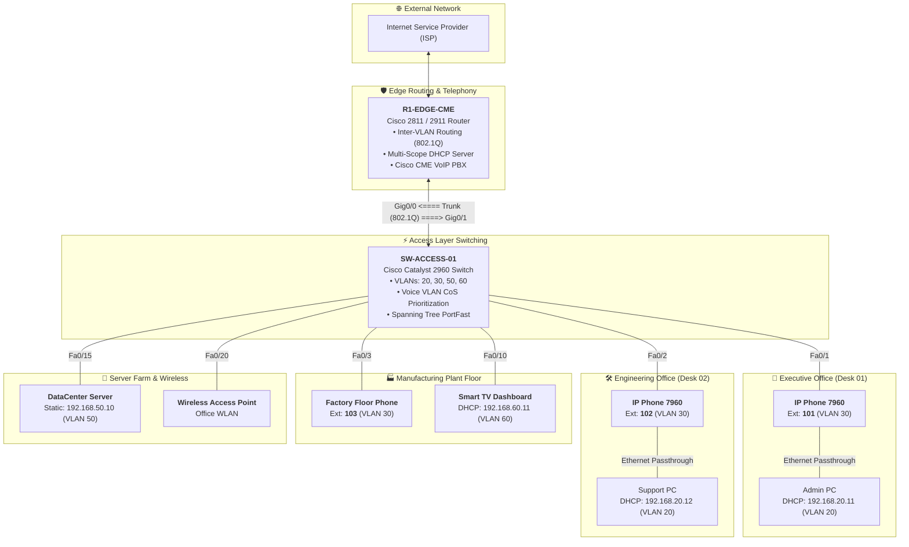
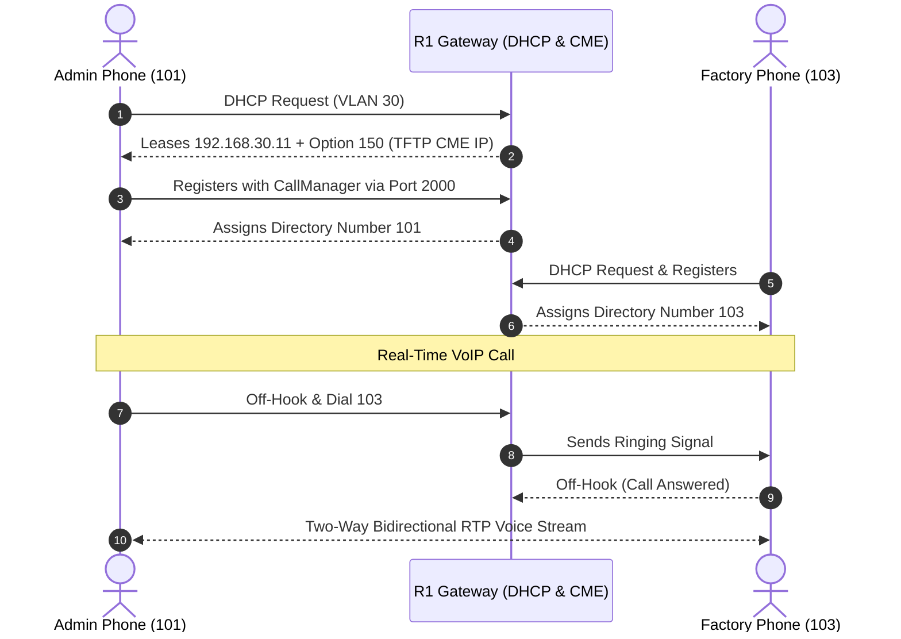

# 🌐 Smart Enterprise & Industrial Factory Network Architecture
### Cisco CCNA Enterprise Project & Packet Tracer Lab

[](https://www.netacad.com/)
[](https://www.cisco.com/)
[](https://www.cisco.com/)
[](https://en.wikipedia.org/wiki/IEEE_802.1Q)

A production-grade campus network architecture designed for modern commercial offices and smart manufacturing plants. The project incorporates high-availability inter-VLAN routing, full voice/data convergence using **Cisco CallManager Express (CME)**, dedicated voice VLAN prioritization, and network segmentation for industrial IoT displays and smart TV dashboards.

---

## 📑 Table of Contents
- [Architecture Overview](#-architecture-overview)
- [Key Features](#-key-features)
- [Network Topology](#-network-topology)
- [VLAN & Subnetting Matrix](#-vlan--subnetting-matrix)
- [Hardware & Device Inventory](#-hardware--device-inventory)
- [VoIP & CME Implementation](#-voip--cme-implementation)
- [Quick Start Guide](#-quick-start-guide)
- [Repository Structure](#-repository-structure)
- [Testing & Verification](#-testing--verification)

---

## 🏛️ Architecture Overview

The design reflects a scalable, two-tier collapsed core and access enterprise campus:
- **Perimeter / Edge:** Cisco 2811/2911 integrated services router providing 802.1Q sub-interface routing (Router-on-a-Stick), multi-pool DHCP server, and on-premises PBX capabilities via Cisco CME.
- **Access Layer:** Cisco Catalyst 2960 switch operating 802.1Q trunk uplinks, port security, and 802.1p Quality of Service (QoS) trust for voice frames.
- **Converged Desktops:** Single-cable workstation connectivity leveraging the 3-port integrated switch inside Cisco IP Phones to separate voice and data streams.
- **Factory IoT Zone:** Smart TV monitors and production dashboards isolated into a dedicated IoT VLAN with direct access to internal ERP and database servers.

---

## ✨ Key Features

- **VoIP Telephony Integration:** Real extension dialing (`101`, `102`, `103`) powered by on-router Cisco Unified Communications Manager Express (CME).
- **Single-Cable Daisy Chaining:** Seamless hardware passthrough from wall jack to IP Phone (Voice VLAN 30, Tagged) and from IP Phone to workstation (Data VLAN 20, Untagged).
- **Automated Host Addressing:** Segregated DHCP scopes distributing appropriate IP pools and TFTP Option 150 pointers.
- **Micro-Segmentation:** Dedicated VLAN boundaries preventing unauthorized lateral movement between factory IoT screens, guest access, and corporate servers.

---

## 🗺️ Network Topology



---

## 📊 VLAN & Subnetting Matrix

| VLAN | Name | Subnet Range | Gateway | Mask | Role & Devices |
| :---: | :--- | :--- | :--- | :--- | :--- |
| **10** | `MANAGEMENT` | `192.168.10.0/24` | `192.168.10.1` | `255.255.255.0` | Switch/Router management interfaces |
| **20** | `DATA_STAFF` | `192.168.20.0/24` | `192.168.20.1` | `255.255.255.0` | Office workstation PCs and laptops |
| **30** | `VOICE_VOIP` | `192.168.30.0/24` | `192.168.30.1` | `255.255.255.0` | Cisco 7960 IP Phones (QoS prioritised) |
| **50** | `SERVERS_DC` | `192.168.50.0/24` | `192.168.50.1` | `255.255.255.0` | Central corporate servers (AD/DNS/File/ERP) |
| **60** | `FACTORY_IOT`| `192.168.60.0/24` | `192.168.60.1` | `255.255.255.0` | Smart TVs, telemetry monitors, industrial displays |

---

## 📦 Hardware & Device Inventory

| Device Type | Packet Tracer Model | Quantity | Role Description |
| :--- | :--- | :---: | :--- |
| **Router** | `Cisco 2811 / 2911` | 1 | Inter-VLAN Gateway, DHCP Server, CME Telephony Host |
| **Switch** | `Catalyst 2960-24TT` | 1 | Layer 2 Access switch with Voice VLAN and Trunking |
| **IP Phones** | `Cisco 7960` | 3 | VoIP terminals with interactive dialing |
| **Workstations** | `Generic PC-PT` | 2 | Staff office computers receiving DHCP addresses |
| **Smart Display** | `Smart Device / TV` | 1 | Shop-floor production dashboard monitor |
| **Server** | `Generic Server-PT` | 1 | Multi-service on-premise application host |
| **Wireless AP** | `AccessPoint-PT` | 1 | Wi-Fi infrastructure |

---

## 📞 VoIP & CME Implementation

The Cisco CallManager Express service runs locally on the gateway router. When an IP phone connects, the following sequence occurs:



---

## 🚀 Quick Start Guide

### 1. Build the Topology in Packet Tracer
Refer to the detailed guide: [`docs/PACKET_TRACER_LAB.md`](docs/PACKET_TRACER_LAB.md)

### 2. Connect the Physical Cables
Use standard **Copper Straight-Through** cables:
- `Router Gig0/0` ➡️ `Switch Gig0/1`
- `Switch Fa0/1` ➡️ `IP Phone 1 (Switch Port)` ➡️ `PC 1 (PC Port)`
- `Switch Fa0/2` ➡️ `IP Phone 2 (Switch Port)` ➡️ `PC 2 (PC Port)`
- `Switch Fa0/3` ➡️ `IP Phone 3 (Switch Port)`
- `Switch Fa0/10` ➡️ `Smart TV (FastEthernet0)`
- `Switch Fa0/15` ➡️ `Server (FastEthernet0)`

> 💡 **Important:** In Packet Tracer, remember to plug the power adapter into each Cisco 7960 IP Phone via its **Physical** tab.

### 3. Apply Configuration Scripts
Copy and paste the CLI commands directly into the terminal of each device:
1. **Edge Router:** [`configs/router_cme.ios`](configs/router_cme.ios)
2. **Access Switch:** [`configs/switch_access.ios`](configs/switch_access.ios)

---

## 🧪 Testing & Verification

1. **IP Phone Registration:** Confirm directory extensions appear on the screens:
   - Executive Phone: `101`
   - Engineering Phone: `102`
   - Factory Floor Phone: `103`
2. **Interactive Call Test:** Open Phone 1 GUI, lift handset, dial `103`, and observe Phone 3 ring in real-time.
3. **Smart TV Addressing:** Verify that the TV displays an IP leased in subnet `192.168.60.0/24`.
4. **End-to-End Connectivity:** From PC 1, execute `ping 192.168.50.10` to confirm reachability across VLAN boundaries to the server farm.

---

## 📁 Repository Structure

```
.
├── .gitignore                      # Git ignore patterns for OS, IDE & Packet Tracer files
├── README.md                       # Main repository documentation & architectural showcase
├── CONTRIBUTING.md                 # Contribution guidelines
├── configs/                        # Production Cisco IOS configuration files
│   ├── router_cme.ios              # Edge router: Inter-VLAN, DHCP scopes, CME PBX
│   ├── switch_access.ios           # Access switch: VLANs, Voice VLAN, Trunking, PortFast
│   └── switch_core_l3.ios          # Multilayer switch alternative (L3 SVIs & Routing)
├── docs/                           # Deep-dive documentation and lab guides
│   ├── ARCHITECTURE.md             # Enterprise campus architectural design notes
│   ├── PACKET_TRACER_LAB.md        # Comprehensive step-by-step assembly manual
│   ├── SUBNETTING_AND_VLANS.md     # IP addressing plans and DHCP configuration tables
│   └── ar/                         # Arabic documentation archive
│       ├── Project_Documentation.md
│       └── Packet_Tracer_Step_By_Step_Guide.md
└── topology/                       # Visual network topology diagrams
    └── network_topology.mermaid    # Raw Mermaid architecture source
```

---

## 📜 License
This project is open-source and intended for educational and CCNA portfolio purposes.
