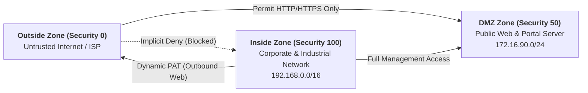

# Enterprise & Industrial Campus Network Architecture

This document provides a comprehensive technical breakdown of the complete enterprise and manufacturing facility architecture, covering Perimeter Security, CCTV Surveillance, Industrial IoT/OT, and VoIP infrastructure.

---

## 1. Perimeter Security & Demilitarized Zone (DMZ)

At the outer boundary of the enterprise, a **Cisco ASA 5506-X Next-Generation Firewall** enforces stateful traffic inspection and access control across three primary security zones:

### Security Policy Rules:
1. **Inbound Traffic:** Outside traffic cannot directly access the `inside` corporate or factory network. Only explicitly permitted public traffic (HTTP/HTTPS) can reach the DMZ web server (`172.16.90.10`).
2. **Stateful Inspection:** Return packets for connections initiated by internal users are dynamically permitted via the ASA state table.
3. **Lateral Movement Prevention:** Compromise of a public DMZ server does not permit transit into internal databases or industrial controllers.

---

## 2. High-Definition Surveillance Subsystem (CCTV & NVR)

Video streams generated by 24/7 security cameras represent persistent high-bandwidth multicast or unicast traffic. Mixing this traffic with user data leads to network congestion and packet jitter.

### Implementation Blueprint:
- **Dedicated Broadcast Domain (VLAN 70):** All PoE IP surveillance cameras are mapped strictly to `VLAN 70` (`192.168.70.0/24`).
- **Power over Ethernet (PoE 802.3at):** Cameras receive inline DC power directly from switch ports `Fa0/9 - 16`.
- **Network Video Recorder (NVR) Archival:** The central NVR / CCTV Storage Server resides in the Server Farm (`192.168.50.50`). Access Control Lists (ACLs) permit camera feeds into the NVR while preventing cameras from scanning administrative PCs.

---

## 3. Industrial IoT & Factory Automation (OT Zone)

Modern smart manufacturing requires deterministic communication between operational technology (OT) equipment, plant managers, and cloud analytical systems.

### Connected Components:
- **Programmable Logic Controllers (PLCs) & HMIs:** Automated assembly and packaging machinery.
- **Environmental & Safety Sensors:** Real-time temperature, humidity, and smoke detection nodes.
- **Biometric & RFID Door Access:** Electronic turnstiles and keycard readers securing physical facilities.
- **Overhead Smart TV Dashboards:** Real-time KPI, Overall Equipment Effectiveness (OEE), and production status monitors on `VLAN 60`.

---

## 4. Shared Office Peripherals (Network Printers)

To avoid security exploits targeting unpatched printer network cards:
- Network Printers and Multi-Function Devices (MFPs) reside in a dedicated peripheral segment (**VLAN 25** - `192.168.25.0/24`).
- Direct inter-VLAN printing is enabled via port `9100` (RAW/JetDirect) and port `631` (IPP) from the Staff Data VLAN, while preventing printers from initiating outbound internet connections.

---

## 5. Enterprise Wireless Infrastructure (WLC & Lightweight APs)

Rather than standalone autonomous access points, corporate Wi-Fi is centralized:
- **Cisco Wireless LAN Controller (WLC):** Handles radio resource management, roaming, and WPA3-Enterprise 802.1X authentication.
- **Dual-SSID Segmentation:**
  - `Corp-Secure`: Authenticated via 802.1X, bridged to `VLAN 40`.
  - `Guest-Internet`: Captive portal with internet-only access, bridged to isolated `VLAN 99`.
